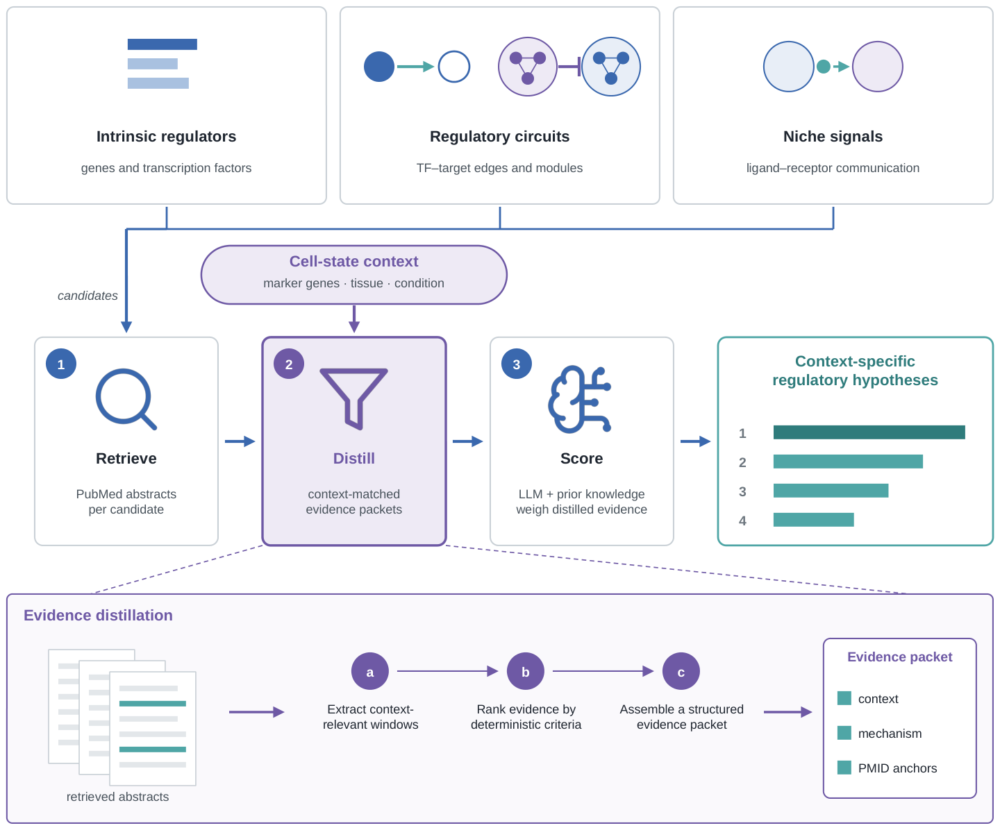

# FateReasoner

**Evidence-grounded LLM reasoning for prioritizing cell-fate regulators.**

Single-cell and spatial analyses produce long candidate lists: differentially expressed genes, TF–target edges from a gene regulatory network (GRN), regulatory modules, and ligand–receptor pairs. FateReasoner re-ranks these candidates for a specific cell state. For each candidate it retrieves PubMed literature, distills the passages that match the cell-state context into a structured evidence packet, and asks an LLM to score the candidate using that packet together with its prior knowledge. Every score can be traced back to the PMIDs it rests on.



FateReasoner works on top of your own analysis. It does not call DEGs, infer GRNs or compute cell–cell communication; it takes their output as candidates.

| Regulatory layer | Candidates | Function |
| --- | --- | --- |
| Intrinsic regulators | genes, TFs | `score_genes` |
| Regulatory circuits | TF → target edges | `score_gene_pairs` |
| Regulatory circuits | module → module relationships | `score_grn_modules` |
| Niche signals | ligand → receptor pairs | `score_gene_pairs` |

## Installation

```bash
pip install git+https://github.com/jiang-junyao/FateReasoner.git
```

or from a local clone:

```bash
git clone https://github.com/jiang-junyao/FateReasoner.git
cd FateReasoner
pip install -e .
```

Python ≥ 3.9 is required. The default distillation is lightweight and needs only `numpy`, `pandas` and `requests`. The optional transformer-based distillation (`distill_evidence="biomedbert_rerank"` or `"medcpt_go"`) needs `pip install -e ".[biomedical]"`.

## LLM providers

FateReasoner has **no default provider**; choose one explicitly for every scoring run. API keys are read from the environment variable below, from `api_key_file=`, or from `api_key=`.

| `provider` | Environment variable |
| --- | --- |
| `deepseek` | `DEEPSEEK_API_KEY` |
| `gpt` | `OPENAI_API_KEY` |
| `claude` | `ANTHROPIC_API_KEY` |
| `gemini` | `GEMINI_API_KEY` |
| `glm` | `ZHIPUAI_API_KEY` |
| `qwen` | `DASHSCOPE_API_KEY` |

Each provider has a preset model, but model names change over time, so set `model=` explicitly for reproducible runs.

Retrieval and distillation need no API key. Setting `prepare_only=True` (or `--prepare-only`) stops after building the evidence packets, which is useful for inspecting the evidence before paying for LLM calls.

## Quick start

### Score candidate genes

```python
from fatereasoner import GeneScoringConfig, score_genes

result = score_genes(
    genes=["TBXT", "MIXL1", "EOMES", "SOX17", "FOXA2", "ACTB"],
    context="human embryonic stem cell differentiation toward definitive endoderm",
    out="results/genes",
    config=GeneScoringConfig(provider="claude", model="claude-sonnet-4-5"),
)
print(result.result[["GENE", "score", "evidence_level", "supporting_pmids"]])
```

`genes` can also be a text file (one gene per line) or a CSV/TSV table with `gene_col=`. `context` can be a string or a path to a text file.

### Score gene pairs (TF → target, ligand → receptor)

```python
from fatereasoner import GenePairScoringConfig, score_gene_pairs

result = score_gene_pairs(
    pairs="examples/data/ligand_receptor_pairs.csv",
    context="oral squamous cell carcinoma tumor microenvironment, fibroblast-tumor communication",
    out="results/lr_pairs",
    config=GenePairScoringConfig(provider="deepseek", model="deepseek-chat"),
)
print(result.result[["candidate_id", "data_score", "fatereasoner_score", "evidence_quadrant"]])
```

The pair table needs `source_gene` and `target_gene`. Optional columns: `candidate_id`, `data_score` (your own score, e.g. a CellChat probability or edge weight, kept as an independent axis), `relation_type` (`tf_target` or `ligand_receptor`), and `sender_celltype` / `receiver_celltype` for ligand–receptor pairs. Pairs with sender/receiver cell types are treated as ligand–receptor pairs automatically.

### Score GRN module pairs

```python
from fatereasoner import GRNModuleScoringConfig, score_grn_modules

result = score_grn_modules(
    network="examples/data/grn_modules.tsv",
    species="mouse",
    context="mouse retinal Muller glia returning to quiescence after injury",
    out="results/grn_modules",
    config=GRNModuleScoringConfig(top_module_pairs=10, provider="gpt", model="gpt-4.1"),
)
```

The network table needs `regulator_symbol`, `source_module`, `target_symbol` and `target_module`; `expression_correlation` and `regulation_type` are optional. [IReNA](https://github.com/jiang-junyao/IReNA) output for mouse or zebrafish is accepted as is.

### Command line

The same workflows are available from the shell:

```bash
fatereasoner score-genes --genes examples/data/hesc_candidate_genes.csv --gene-col GENE \
    --context examples/data/hesc_context.txt --out results/genes \
    --provider claude --model claude-sonnet-4-5

fatereasoner score-gene-pairs --pairs examples/data/gene_pairs.csv \
    --context examples/data/retina_context.txt --out results/tf_target --prepare-only

fatereasoner score-grn-modules --network examples/data/grn_modules.tsv --species mouse \
    --context examples/data/retina_context.txt --out results/grn_modules --provider deepseek
```

Run `fatereasoner <command> --help` for all options.

## Examples

`examples/` contains three runnable scripts with small input files in `examples/data/`. Without `--provider` they stop after evidence distillation, so they run without an API key:

```bash
python examples/01_score_genes.py                       # genes, hESC -> definitive endoderm
python examples/02_score_gene_pairs.py                  # TF -> target and ligand -> receptor pairs
python examples/03_score_grn_modules.py                 # GRN module pairs

python examples/01_score_genes.py --provider claude --model claude-sonnet-4-5   # full scoring
```

## Outputs

Each run writes to its `out` directory:

| File | Content |
| --- | --- |
| `*_packets.jsonl` | one distilled evidence packet per candidate (context, selected passages, PMIDs) |
| `distilled_*_packets.csv` | the same packets as a table |
| `gene_scores.csv` / `gene_pair_scores.csv` / `module_pair_scores.csv` | final table: score, evidence level, supporting PMIDs, rationale and caveats |
| `*_response.txt`, `*_api_response.jsonl` | raw LLM responses, kept for auditing |

For gene pairs and modules the final table keeps your `data_score` next to `fatereasoner_score`, and `evidence_quadrant` labels each candidate as `concordant_high`, `data_high_llm_lower`, `llm_high_data_lower` or `lower_concordance`.

## Useful options

| Option | Purpose |
| --- | --- |
| `prepare_only=True` | build evidence packets only, no LLM call |
| `exclude_pmids="123;456"` | exclude specific PMIDs from retrieval, e.g. the paper your data came from |
| `date_cutoff="2020/12/31"` | use only literature published up to a date |
| `method=` | `distilled_plus_prior` (default) or the ablations `prior_only`, `distilled_only_no_prior`, `raw_abstract_plus_prior`, `biomedbert_plus_prior` |
| `resume=True` | reuse cached retrieval and scores after an interruption |

## Citation

If you use FateReasoner, please cite:

> Jiang J. *et al.* Decoding cell fate decisions across regulatory layers with evidence-grounded LLM reasoning. (manuscript in preparation)

## License

MIT
