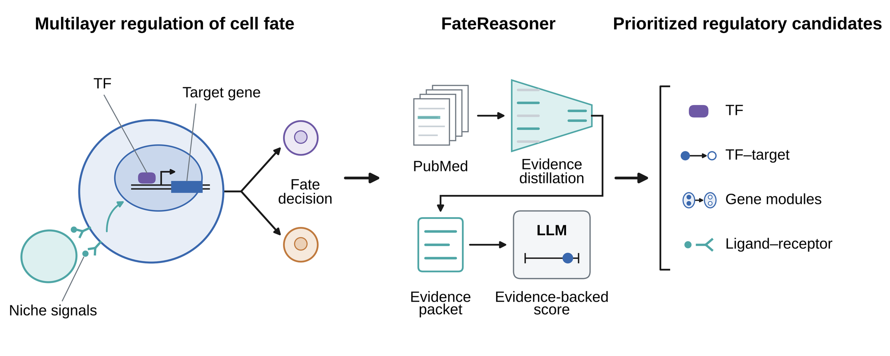

<h1 align="center">FateReasoner</h1>

<p align="center">
  <b>Evidence-grounded LLM reasoning for prioritizing regulators of cell fate</b>
</p>

<p align="center">
  
</p>

Single-cell, spatial and multiomic analyses produce long lists of candidate regulators: differentially expressed genes, TF–target edges, gene regulatory network (GRN) modules and ligand–receptor pairs. Data-driven scores tell you how strongly a candidate is associated with a cell state, but not whether the literature supports it as a regulator of the fate transition you are studying.

FateReasoner adds that layer. For each candidate it retrieves PubMed literature, distills the passages that match your biological context into a compact evidence packet, and asks a large language model (LLM) to weigh this evidence together with its prior knowledge. The result is an **evidence score** for every candidate, linked to the publications that support it.

- **Context-matched evidence.** Evidence is selected for the cell fate transition you describe, not for the gene in general.
- **Traceable.** Every score comes with the supporting PMIDs, an evidence level and a short rationale.
- **One workflow across regulatory layers.** Genes, TF–target edges, GRN modules and ligand–receptor pairs.
- **Model-agnostic.** Works with DeepSeek, OpenAI GPT, Anthropic Claude, Google Gemini, Zhipu GLM and Alibaba Qwen.
- **Works on top of your analysis.** FateReasoner does not call DEGs, infer GRNs or compute cell–cell communication; it takes their output as input.

---

## Installation

```bash
pip install git+https://github.com/jiang-junyao/FateReasoner.git
```

or from a local clone:

```bash
git clone https://github.com/jiang-junyao/FateReasoner.git
cd FateReasoner
pip install -e .
```

Python ≥ 3.9 is required. The default pipeline needs only `numpy`, `pandas` and `requests`. The optional transformer-based evidence selection (`distill_evidence="biomedbert_rerank"` or `"medcpt_go"`) needs `pip install -e ".[biomedical]"`.

## Set up an LLM

FateReasoner has **no default provider**: choose one for every run. The API key is read from the environment variable below, or passed with `api_key=` / `api_key_file=`.

| `provider` | Environment variable |
| --- | --- |
| `deepseek` | `DEEPSEEK_API_KEY` |
| `gpt` | `OPENAI_API_KEY` |
| `claude` | `ANTHROPIC_API_KEY` |
| `gemini` | `GEMINI_API_KEY` |
| `glm` | `ZHIPUAI_API_KEY` |
| `qwen` | `DASHSCOPE_API_KEY` |

Each provider has a preset model. Model names change over time, so set `model=` explicitly for reproducible runs.

PubMed retrieval needs no key. Setting `NCBI_EMAIL` and `NCBI_API_KEY` is recommended for faster, more reliable access to NCBI.

## Quick start

Pick the function that matches your candidates. Each call is one line; the example files are in [`examples/data`](examples/data).

| Your candidates | Typical source | Function |
| --- | --- | --- |
| Genes or TFs | differential expression, TF ranking | `score_genes` |
| TF → target edges | GRN inference | `score_gene_pairs` |
| Module → module regulation | module-annotated GRN (e.g. IReNA) | `score_grn_modules` |
| Ligand → receptor pairs | cell–cell communication (e.g. CellChat, LIANA) | `score_gene_pairs` |

```python
from fatereasoner import *

# Genes or TFs
score_genes("examples/data/hesc_candidate_genes.csv", "examples/data/hesc_context.txt", "results/genes", gene_col="GENE", config=GeneScoringConfig(provider="deepseek"))

# TF -> target edges
score_gene_pairs("examples/data/gene_pairs.csv", "examples/data/retina_context.txt", "results/tf_target", config=GenePairScoringConfig(provider="deepseek"))

# GRN module -> module regulation
score_grn_modules("examples/data/grn_modules.tsv", "mouse", "examples/data/retina_context.txt", "results/modules", config=GRNModuleScoringConfig(provider="deepseek"))

# Ligand -> receptor pairs
score_gene_pairs("examples/data/ligand_receptor_pairs.csv", "examples/data/tumor_context.txt", "results/lr", config=GenePairScoringConfig(provider="deepseek"))
```

Each call returns a `ScoringResult`; `result.result` is the final table as a `pandas.DataFrame`.

The same workflows are available from the command line:

```bash
fatereasoner score-genes --genes examples/data/hesc_candidate_genes.csv --gene-col GENE --context examples/data/hesc_context.txt --out results/genes --provider deepseek
fatereasoner score-gene-pairs --pairs examples/data/gene_pairs.csv --context examples/data/retina_context.txt --out results/tf_target --provider deepseek
fatereasoner score-grn-modules --network examples/data/grn_modules.tsv --species mouse --context examples/data/retina_context.txt --out results/modules --provider deepseek
```

Run `fatereasoner <command> --help` for all options.

> **Tip.** Add `prepare_only=True` (or `--prepare-only`) to stop after building the evidence packets. This needs no LLM key and lets you inspect the evidence before paying for LLM calls.

## Inputs

**Context.** A short description of the cell fate transition, as a string or a text file, for example *"mouse retinal Müller glia returning to quiescence after injury"*. Tissue, condition, cell types and marker genes all help evidence selection.

**Genes.** A Python list, a text file with one gene per line, or a CSV/TSV table (set `gene_col=`).

**Gene pairs.** A CSV/TSV table with `source_gene` and `target_gene`. Optional columns:

| Column | Meaning |
| --- | --- |
| `candidate_id` | your identifier for the pair |
| `data_score` | your own score (edge weight, CellChat probability, LIANA rank…), kept as an independent axis |
| `relation_type` | `tf_target` or `ligand_receptor` |
| `sender_celltype`, `receiver_celltype` | cell types for ligand–receptor pairs; their presence marks a pair as ligand–receptor |

**GRN modules.** An edge table with `regulator_symbol`, `source_module`, `target_symbol` and `target_module` (`expression_correlation` and `regulation_type` are optional). [IReNA](https://github.com/jiang-junyao/IReNA) output for mouse or zebrafish is accepted as is.

## Outputs

Each run writes to its output directory:

| File | Content |
| --- | --- |
| `gene_scores.csv` / `gene_pair_scores.csv` / `module_pair_scores.csv` | final table: evidence score, evidence level, supporting PMIDs, rationale and caveats |
| `*_packets.jsonl`, `distilled_*_packets.csv` | the distilled evidence packet for each candidate |
| `*_response.txt`, `*_api_response.jsonl` | raw LLM responses, kept for auditing |

For gene pairs and modules, the evidence score is in `fatereasoner_score`. Your `data_score` is kept next to it, and `evidence_quadrant` labels each candidate as `concordant_high`, `data_high_llm_lower`, `llm_high_data_lower` or `lower_concordance`, which makes candidates supported by the data but not yet by the literature (and the reverse) easy to find.

## Useful options

All options can be set in the config object (Python) or as flags (command line).

| Option | Default | Purpose |
| --- | --- | --- |
| `full_text` | `"pmc-oa"` | use open-access PubMed Central full texts when available; `"none"` uses titles and abstracts only |
| `exclude_pmids` | `""` | PMIDs to exclude from retrieval, e.g. the study your candidates came from |
| `date_cutoff` | `None` | use only literature published up to a date |
| `prepare_only` | `False` | build evidence packets only, without calling the LLM |
| `resume` | `False` | reuse cached retrieval and scores after an interruption |
| `method` | `"distilled_plus_prior"` | FateReasoner scoring, or the ablations `prior_only`, `distilled_only_no_prior`, `raw_abstract_plus_prior`, `biomedbert_plus_prior` |
| `temperature` | `0.0` | LLM sampling temperature |

## How it works

1. **Retrieve.** PubMed is queried with the candidate genes combined with terms from your context.
2. **Distill.** Sentences that mention the candidate or the context form short text windows. Windows are ranked by a fixed hierarchy of criteria (candidate mention, context terms, marker genes, functional terms, absence of off-context or species-mismatched content, PubMed rank), and the best are assembled into a compact evidence packet together with the supporting PMIDs.
3. **Score.** The LLM reads the packet, weighs it together with its prior knowledge, and returns an evidence score between 0 and 1, an evidence level, the supporting PMIDs and a short rationale. Scoring instructions are adapted to genes, directed gene pairs and module pairs.

## Citation

If you use FateReasoner, please cite:

> Jiang J., Yang R., Kong A., Huang D. and Chen X. Decoding cell fate decisions across regulatory layers with evidence-grounded LLM reasoning. *Manuscript submitted.*

## License

MIT
